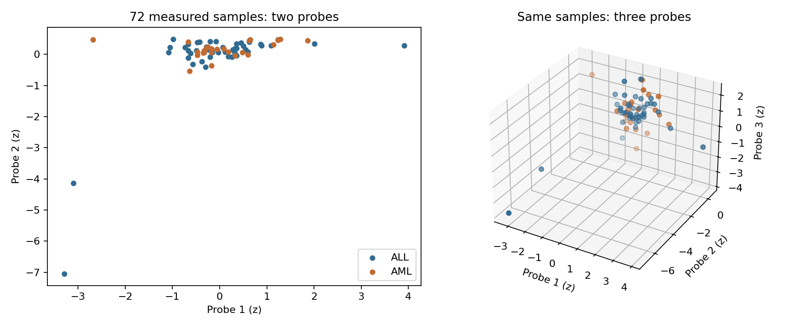
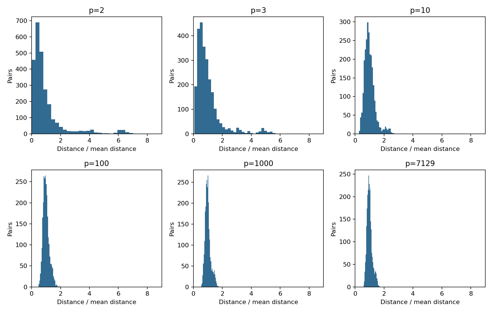
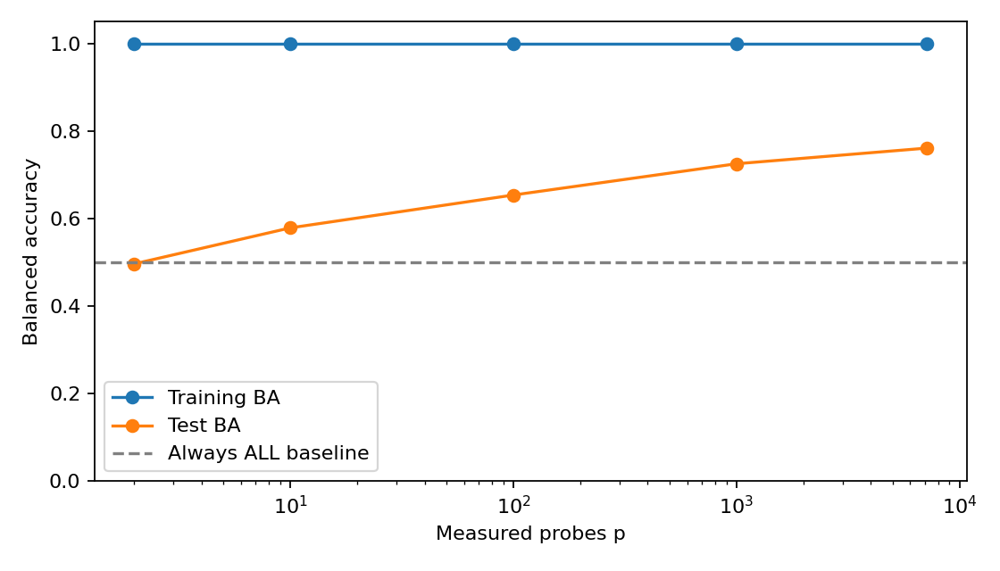

## 摘要

本报告使用 72 份白血病微阵列表达样本及 7,129 个探针，考察纳入探针数量与样本间距离、1 近邻分类表现及特征筛选稳定性的关系。数据包含 47 份 ALL 和 25 份 AML 表达样本；原始划分为训练集 38 份、测试集 34 份。距离分析中，seed=42 时探针数由 2 增至 7,129，平均欧氏距离由 1.2688 增至 118.1965，而距离变异系数（CV）由 1.2328 降至 0.1870。固定划分下，测试平衡准确率由 0.4964 增至 0.7607，但所有维度的重代入训练 BA 均为 1.0000。训练集内 3 折×3 次重复验证中，折内筛选 20 个探针的平均验证 BA 为 0.8858，全部探针为 0.8441；筛选集合的中位 Jaccard 相似度仅为 0.2702。结果说明，本数据中更多探针伴随更集中的相对距离和更高的当前测试分数，但不能推出“特征越多必然越好”，也不能据此保证对新患者的泛化。

## 研究问题

高维表达矩阵通常具有特征数远多于样本数的结构。本研究围绕一个具体问题展开：当同一批样本逐步纳入更多实测探针时，样本距离分布和分类结果如何变化？这些变化是否足以支持“特征越多，模型一定越好”？

我们使用 Golub 白血病表达数据的课程副本。每行代表一份表达样本，标签为 ALL（急性淋巴细胞白血病）或 AML（急性髓系白血病）；每个表达列对应一个探针。数据有 72 行和 7,129 个探针，p/n 约为 99.0。探针不等同于不同基因，更不等于彼此独立的信息。教学编号 G001–G072 也不能证明样本来自 72 位互不重复的患者；数据没有患者重复映射、中心或批次字段。

## 实验设计

### 距离分析 A

固定全部 72 份样本，对每个探针逐列进行 z-score 标准化（总体标准差，ddof=0），以随机种子 42、7、2026 生成探针列排列，并按排列前缀比较 p=2、3、10、100、1,000、7,129。随机操作只决定选入哪些已有探针，不改变表达值或诊断标签。对每个 p 计算 2,556 个样本对的欧氏距离均值、标准差和 CV（距离标准差/距离均值）。同时逐样本排除自身，计算最近邻、最远邻及 R=(最远邻距离−最近邻距离)/最近邻距离，并报告 R 中位数。

### 分类实验 B

保留原始训练/测试划分（38/34），沿用 seed=42 的列序比较 p=2、10、100、1,000、7,129。模型流程固定为训练集拟合 StandardScaler 后使用 1 近邻；测试集只应用训练集拟合的标准化变换。性能以平衡准确率（BA）表示，即 ALL 与 AML 两类召回率的平均值。该测试集用于本次课程内的固定划分比较，不用于选择最佳 p。

### 训练内验证与筛选稳定性

在原始 38 份训练样本上进行分层 3 折×3 次重复验证，比较全部 7,129 个探针与每个训练折内以 ANOVA F 分数筛选 20 个探针的 1 近邻流程。标准化和特征选择均只在每折训练部分拟合，再应用于该折验证部分。两个流程共用相同的折划分。9 个所选探针集合两两比较 Jaccard 相似度，即交集大小除以并集大小。

## 结果

### 距离随探针数增加而相对集中

第一张表仅展示 seed=42 的六种探针数：平均欧氏距离随 p 增加而上升，距离 CV 则下降。平均距离增加与相对分布变窄并不矛盾：前者描述绝对尺度，后者描述距离相对于平均值的变异。第二张表另列 seed=42、7、2026 的近远邻统计，用于比较不同选列顺序；低维时选入的具体探针不同，结果也会不同。两表数值均四舍五入至四位小数。

| 探针数 p | 平均距离 | 距离标准差 | 距离 CV |
|---:|---:|---:|---:|
| 2 | 1.2688 | 1.5641 | 1.2328 |
| 3 | 1.8101 | 1.6757 | 0.9257 |
| 10 | 4.2151 | 1.5859 | 0.3762 |
| 100 | 13.9169 | 3.0225 | 0.2172 |
| 1,000 | 44.1816 | 8.7269 | 0.1975 |
| 7,129 | 118.1965 | 22.0999 | 0.1870 |

| Seed | 探针数 p | 最近邻距离中位数 | 最远邻距离中位数 | 绝对近远差中位数 | R 中位数 | 零最近邻数 |
|---:|---:|---:|---:|---:|---:|---:|
| 42 | 2 | 0.0675 | 7.9030 | 7.8600 | 115.4520 | 0 |
| 42 | 3 | 0.2345 | 8.7639 | 8.4827 | 35.9983 | 0 |
| 42 | 10 | 1.7976 | 9.6558 | 7.5595 | 4.3187 | 0 |
| 42 | 100 | 9.6696 | 21.4616 | 12.0114 | 1.1994 | 0 |
| 42 | 1,000 | 33.0673 | 66.5154 | 34.2368 | 1.0489 | 0 |
| 42 | 7,129 | 87.9311 | 174.9003 | 87.1380 | 0.9669 | 0 |
| 7 | 2 | 0.1774 | 4.5466 | 4.2342 | 23.6760 | 0 |
| 7 | 3 | 0.4549 | 5.2443 | 4.6675 | 10.1981 | 0 |
| 7 | 10 | 2.1112 | 7.5852 | 5.3174 | 2.4010 | 0 |
| 7 | 100 | 9.8414 | 22.9329 | 13.0792 | 1.2864 | 0 |
| 7 | 1,000 | 32.8363 | 66.2803 | 32.8760 | 0.9963 | 0 |
| 7 | 7,129 | 87.9311 | 174.9003 | 87.1380 | 0.9669 | 0 |
| 2026 | 2 | 0.1596 | 5.0318 | 4.8858 | 30.1904 | 0 |
| 2026 | 3 | 0.4033 | 5.1290 | 4.7097 | 11.4875 | 0 |
| 2026 | 10 | 1.9833 | 7.7836 | 5.9400 | 3.1810 | 0 |
| 2026 | 100 | 9.6842 | 21.7892 | 11.8402 | 1.1829 | 0 |
| 2026 | 1,000 | 33.0449 | 65.8883 | 32.3077 | 0.9597 | 0 |
| 2026 | 7,129 | 87.9311 | 174.9003 | 87.1380 | 0.9669 | 0 |

G001 的例子显示相对差异下降并不表示绝对距离差趋近于零：seed=42、p=2 时最近邻与最远邻分别约为 0.0492 和 7.9541，R=160.6959；p=7,129 时分别约为 93.6958 和 156.1462，R=0.6665。全体样本的绝对近远距离差中位数从 7.8600 增至 87.1380。相对近远差缩小可能使距离方法的邻近程度区分变弱，但本身不能直接决定分类表现。三个 seed 在 p=7,129 时结果相同，因为此时使用了全部探针，列排列不会改变欧氏距离；所有条件的零最近邻数均为 0。

*图 1｜相同 72 份表达样本在 seed=42 列序下前两个及前三个探针上的投影。颜色按诊断标签事后着色；此图只展示 2 或 3 个探针，不能代表全部 7,129 维结构，也不能单独证明类别可分或不可分。前三个探针为 X51730_at、U13616_at、X97261_at。*

*图 2｜seed=42 下各条件的样本对欧氏距离分布。横轴为距离除以该条件的平均距离，因此图形用于比较相对分布形状，而非原始距离尺度。随着 p 增加，分布相对变窄；这不是所有数据集或距离度量的普遍定律。*

### 固定划分上的测试 BA 随 p 上升

训练集上的 BA 在全部 p 条件下均为 1.0000。测试 BA 随 p 从 2 增至 7,129 而逐步上升，p=2 时接近恒预测 ALL 的 BA 基线 0.5000，p=7,129 时为 0.7607。由于 1 近邻重代入训练样本时可以把样本自身作为距离为零的最近邻，训练满分主要反映训练记忆，不能作为泛化证据。

| 探针数 p | 训练 BA | 测试集 ALL 正确/20 | 测试集 AML 正确/14 | 测试 BA |
|---:|---:|---:|---:|---:|
| 2 | 1.0000 | 17/20 | 2/14 | 0.4964 |
| 10 | 1.0000 | 16/20 | 5/14 | 0.5786 |
| 100 | 1.0000 | 19/20 | 5/14 | 0.6536 |
| 1,000 | 1.0000 | 19/20 | 7/14 | 0.7250 |
| 7,129 | 1.0000 | 19/20 | 8/14 | 0.7607 |

*图 3｜原始 38/34 划分上的训练和测试平衡准确率。灰色虚线为恒预测 ALL 的 BA=0.5。测试曲线描述这一固定划分，不能替代独立队列验证；也不应据本次结果把 p=7,129 宣称为普遍最优。*

### 折内筛选的平均分略高但特征集合不稳定

训练集内重复验证的全部探针流程平均验证 BA 为 0.8441（范围 0.6944–1.0000）；折内筛选 20 个探针的平均验证 BA 为 0.8858（范围 0.7500–1.0000）。筛选流程并非每一折均胜出，例如第二次重复的第三折中，全部探针 BA 为 1.0000，筛选 20 个探针为 0.8333。因而平均分差异不能说明筛选在每次划分都有效。

| 训练内验证流程 | 验证 BA 均值 | 验证 BA 最小值 | 验证 BA 最大值 |
|:---|---:|---:|---:|
| 全部 7,129 探针 | 0.8441 | 0.6944 | 1.0000 |
| 每个训练折内筛选 20 探针 | 0.8858 | 0.7500 | 1.0000 |

9 个筛选集合的 36 个两两 Jaccard 相似度中位数为 0.2702，范围 0.1429–0.4286，提示在当前小样本和筛选规则下，入选列表对训练划分较敏感。重复交叉验证的折共享样本，9 个分数不是 9 次独立研究，也不应被当成独立队列证据。当前分析固定 k=20；若要从多个 k 或模型中择优，应在内层验证选择，在外层评估整个选择流程，并保留独立测试集至最后。

## 解释与限制

本次结果并不支持“特征更多必然更好”或“特征更多必然更差”。距离 CV 下降说明在这份数据、逐列标准化和欧氏距离条件下，样本对距离的相对分布变窄；它不意味着绝对距离变小，也不意味着分类一定下降。另一方面，当前测试 BA 随探针数提高，可能是新增探针提供了有用表达信号，也可能与具体列子集、数据划分和小样本波动有关。本实验同时改变了特征数量和选入的探针内容，因此不能把差异单独归因于维度数。

高维小样本情境还带来几类风险：距离可区分度可能下降；使用大量探针逐项检验时会增加偶然显著发现的机会；在小样本中筛选出的探针可能随划分改变；若先用全体样本标签筛选特征或拟合标准化，再交叉验证分类器，就会让验证数据的信息渗入训练流程，导致性能估计偏乐观。规范流程应在每个训练折内拟合标准化和特征筛选，再仅将拟合后的变换与探针列表应用于验证折；最终测试集不得按其标签重新选列。

若 7,129 项检验的原假设全部成立，且每项 I 类错误率为 0.05，假阳性的理论期望为 7,129×0.05=356.45。这不是本数据实际发现的假阳性数，也不是差异探针或差异基因数量。FDR 控制的是被宣布显著的结果中假发现比例的期望，而不是给每个显著结果一个确定的真伪判断。

本报告还有明确的推断边界：样本数仅 72；患者重复映射和批次信息缺失，无法确认独立患者数或排除批次混杂；测试集沿用课程给定的一次划分，不是独立中心的外部验证；探针层面的预测关联不能证明生物学因果或临床有效性。距离结果也固定于 z-score 与欧氏距离，其他尺度处理、相关结构或距离度量可能改变排序与结论。

## 结论

在本次白血病微阵列数据中，增加纳入探针数伴随欧氏距离 CV 下降、固定测试集 BA 上升；但训练 BA 全程为 1.0000，且 20 探针筛选集合的跨折稳定性有限。证据支持的结论是：更多已有特征可能增加预测信号，也可能带来冗余、噪声、多重检验和选择不稳定，必须通过无泄漏验证评估完整建模流程。下一步应在确认患者独立、记录中心与批次信息的外部新队列中，预先固定标准化、筛选、模型和评价方案后进行验证，并报告不确定性。

## 数据与复现

数据为 Golub 白血病微阵列表达数据的 OpenML 数据集 1104（version 1）课程副本。原始数据包含 ALL/AML 诊断标签；本实验将 `sample_id` 与 `original_split` 仅用于索引和划分，不作为模型特征。实验参数、代码和输出文件以课程目录中的 `experiment-design.md`、`scripts/experiments.py` 与 `student-results` 为准；本报告保留工作单已填数值和已有代码生成图，不另行挑选测试集上的“最佳”结果。

## 参考文献

1. Golub TR, et al. Molecular Classification of Cancer: Class Discovery and Class Prediction by Gene Expression Monitoring. *Science*. 1999;286(5439):531–537. [doi:10.1126/science.286.5439.531](https://doi.org/10.1126/science.286.5439.531).
2. OpenML. Leukemia dataset, data ID 1104, version 1. [Dataset record](https://www.openml.org/d/1104).
