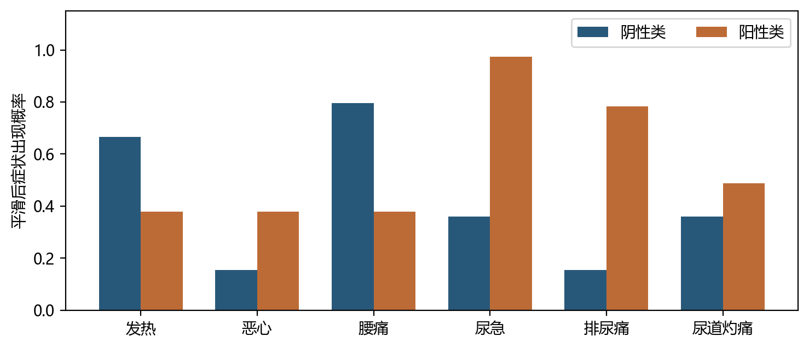
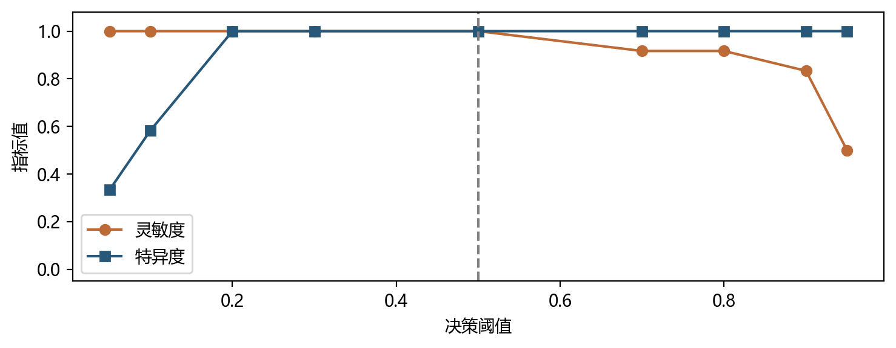
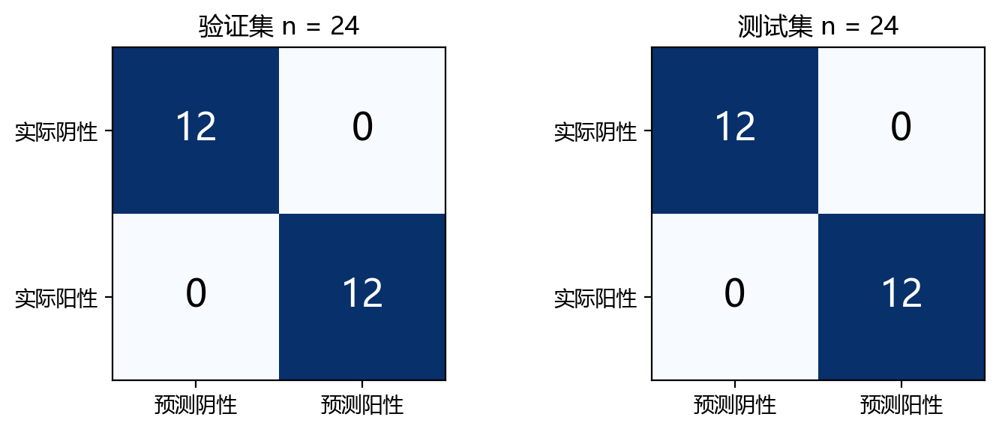
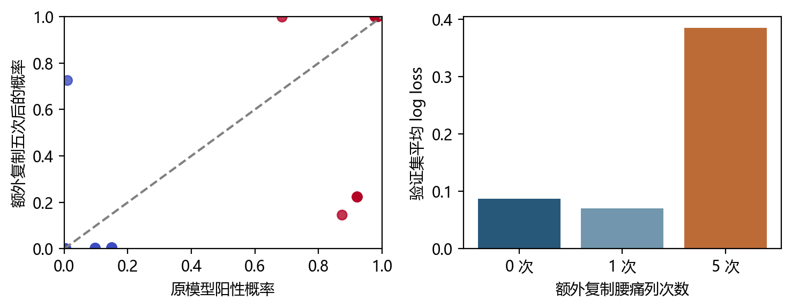
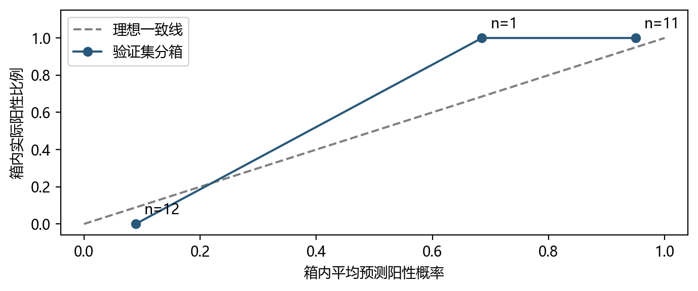

# 基于症状数据的朴素贝叶斯分类与评价

## 摘要

本研究使用 UCI Acute Inflammations 数据中的 120 条专家构造记录，以六项二元症状预测膀胱炎标签。保持 72 条训练、24 条验证和 24 条测试的固定划分，采用 Laplace 平滑系数为 1 的 Bernoulli 朴素贝叶斯模型。参数仅由训练集估计，阈值依据验证集的灵敏度与特异度确定。选定阈值为 0.5，验证集和测试集均得到 24/24 的正确分类，平均对数损失分别为 0.087214 和 0.074492。重复输入实验表明，未增加新信息的症状副本仍可改变概率和类别。由于全部数据仅有 9 种症状组合，且测试组合均在训练中出现，结果支持同源数据中的规则再现，尚不足以证明真实临床人群中的泛化能力。

关键词：朴素贝叶斯；条件独立；分类评价；对数损失；数据划分

## 一 研究问题与分析对象

分析问题是：如何由已知症状与标签估计预测关系，以及如何判断这一关系在保留记录上是否有效。一条样本是数据表中的一条专家构造记录；特征是记录中可用于预测的症状；标签是是否存在膀胱炎。记录不等同于独立患者，预测概率也不能直接解释为已获临床验证的患病风险。

## 二 数据处理与评价设计

六项输入依次为体温不低于 38°C、恶心、腰痛、尿急、排尿痛及尿道灼痛，出现编码为 1，未出现为 0。原始连续温度只用于生成发热指标；样本 ID 用于关联与审计。ID、原始温度和另一疾病标签 nephritis 均不进入模型，以避免改变既定特征定义或引入标签信息。

| 数据部分 | 记录数 | 阴性 | 阳性 | 用途 |
| --- | --- | --- | --- | --- |
| 训练集 | 72 | 37 | 35 | 估计参数 |
| 验证集 | 24 | 12 | 12 | 评价与选阈值 |
| 测试集 | 24 | 12 | 12 | 留出复算 |

三个集合的 ID 两两不重叠。逐列核查显示，六输入与主标签不存在缺失，输入取值均为 0 或 1。验证集中 24/24 条、测试集中 24/24 条记录的六输入组合在训练集中出现过。新的一行记录与未见过的症状组合并非同一概念，ID 不重叠不能保证输入模式独立。

原始数据共有 120 条记录；六输入二元化后仅有 9 种组合。按除 ID 外全部保留字段比较，有 21 条额外完全重复记录。分析保留固定划分而不重新去重，因此评价范围限定为该构造数据的同源留出表现。

本报告按既定协议复算现有数据，阈值不使用测试标签选择；并未据此声称已经完成教师释放程序、预注册或前瞻性盲评。测试后不更换输入、调整平滑系数或合并验证集重训。

## 三 从训练计数到后验概率

数据模型可写为 p=fθ(x)，其中 x 为六项症状，θ 为由训练数据估计的参数，p 为阳性概率。训练改变参数，预测只将新输入代入固定模型。以单症状教学数据为例，无排尿痛的 3 条中有 1 条阳性，有排尿痛的 5 条中有 4 条阳性，故经验概率分别为 1/3 和 4/5。增加一条有排尿痛但阴性的记录并重新训练，后者变为 4/6；只调用预测则不会更新它。

同一教学例子中，P(Y=1)=5/8，P(x=1|Y=1)=4/5，P(x=1|Y=0)=1/3。Bayes 公式将阳性权重 (5/8)×(4/5)=1/2 与阴性权重 (3/8)×(1/3)=1/8 归一化，得到 P(Y=1|x=1)=0.8。类内症状概率与给定症状后的疾病概率具有不同分母，不能互换。

六个二元特征共有 2⁶=64 种可能组合。朴素贝叶斯以给定类别后特征条件独立为近似，将联合似然拆成六个单特征因子；该假设并非要求总体症状彼此独立。训练中先验为 πc=nc/n，平滑后症状出现概率为 θcj=(kcj+1)/(nc+2)。

类别权重 wc=πc∏j[θcj^xj(1−θcj)^(1−xj)]，阳性后验为 p=w1/(w0+w1)。因此无症状也提供证据，xj=0 时必须使用补概率 1−θcj。平滑避免零计数导致乘积归零，但不能消除特征依赖或数据偏倚。

## 四 六症状预测的手工核验

固定输入 x=(0,0,0,1,1,1)，表示无发热、无恶心、无腰痛，同时出现尿急、排尿痛与尿道灼痛。训练集阴性 37 条、阳性 35 条，故 π0=37/72、π1=35/72。下表列出用于权重相乘的实际似然项。

| 特征 | 输入 | 阴性计数¹ | 阳性计数¹ | 阴性似然 | 阳性似然 |
| --- | --- | --- | --- | --- | --- |
| 发热 | 0 | 25 | 13 | 0.333333 | 0.621622 |
| 恶心 | 0 | 5 | 13 | 0.846154 | 0.621622 |
| 腰痛 | 0 | 30 | 13 | 0.205128 | 0.621622 |
| 尿急 | 1 | 13 | 35 | 0.358974 | 0.972973 |
| 排尿痛 | 1 | 5 | 28 | 0.153846 | 0.783784 |
| 尿道灼痛 | 1 | 13 | 17 | 0.358974 | 0.486486 |

¹ 计数指该类别中症状为 1 的记录数；当当前输入为 0 时，似然项使用平滑后症状概率的补数。

将六项似然分别与类别先验相乘，得到 w0=0.0005894354，w1=0.0433193284；归一化得到 p=0.9865759063。在阈值 0.5 下预测为阳性。该概率是模型在给定参数与条件独立近似下的输出，不是个体诊断的确定性结论。

进一步采用独立的计数乘积路径，对验证集和测试集逐条计算后验，再与 sklearn 的 predict_proba 输出比较，结果在数值精度内一致。这一核验同时检查了先验、无症状项、平滑分母和归一化步骤。

## 五 概率误差与类别误差

二分类对数损失为 ℓ(y,p)=−[y ln p+(1−y)ln(1−p)]，数据集损失为各记录损失的平均，数值越小越好。对真实标签为 1、0 的两个样本，模型 A 给出 0.6、0.4，模型 B 给出 0.9、0.1，两者 accuracy 均为 1，但平均损失分别为 0.510826 与 0.105361。B 给真实类别分配的概率更高。

当 y=0 时，p=0.6 与 p=0.99 都分类错误，损失分别为 0.916291 与 4.605170。后者几乎排除了真实类别，因此受到更大惩罚。accuracy 只保留跨阈值后的类别，无法表达这种差别。本模型通过训练计数估参，不通过梯度下降最小化验证损失。

## 六 分类指标与验证集阈值选择

混淆矩阵以真实类别为行、预测类别为列。TP 为检出的真实阳性，FN 为漏检阳性，FP 为误报阳性，TN 为正确识别的阴性。灵敏度 TP/(TP+FN) 的分母是真实阳性；精确率 TP/(TP+FP) 的分母是预测阳性，二者不能混淆。

| 指标 | 计算式 | 含义 |
| --- | --- | --- |
| 准确率 | (TP+TN)/n | 全部记录中分类正确比例 |
| 灵敏度 | TP/(TP+FN) | 真实阳性中检出比例 |
| 特异度 | TN/(TN+FP) | 真实阴性中排除比例 |
| 精确率 | TP/(TP+FP) | 预测阳性中实际阳性比例 |
| F1 | 2TP/(2TP+FP+FN) | 精确率与召回率的调和平均 |

以八条独立教学预测为例，在阈值 0.5 下 TN=3、FP=1、FN=2、TP=2，准确率为 5/8，灵敏度为 2/4，特异度为 3/4，精确率为 2/3，F1 为 4/7。将阈值降至 0.3 后，TP=3、FN=1、FP=3、TN=1，灵敏度升至 0.75，特异度降至 0.25。概率与参数未改变，改变的是概率到类别的决策规则。

| 阈值 | FP | FN | 灵敏度 | 特异度 |
| --- | --- | --- | --- | --- |
| 0.1 | 5 | 0 | 1.0000 | 0.5833 |
| 0.5 | 0 | 0 | 1.0000 | 1.0000 |
| 0.9 | 0 | 2 | 0.8333 | 1.0000 |

选择规则为先满足灵敏度不低于 0.90，再最大化特异度；并列时优先最接近 0.5 的阈值，仍并列取较小者。网格比较得到 t=0.5。低阈值增加检出倾向，但也可能带来误报；该规则用于本次分析，不代表临床最优决策。

## 七 训练 验证与留出测试结果

| 模型与数据 | accuracy | log loss | TN / FP / FN / TP |
| --- | --- | --- | --- |
| NB 训练 | 1.0000 | 0.098840 | 37 / 0 / 0 / 35 |
| NB 验证 | 1.0000 | 0.087214 | 12 / 0 / 0 / 12 |
| NB 测试 | 1.0000 | 0.074492 | 12 / 0 / 0 / 12 |
| 先验基线 验证 | 0.5000 | 0.693533 | 12 / 0 / 12 / 0 |

先验基线对所有输入输出训练集阳性比例 35/72≈0.4861；在阈值 0.5 下全部预测阴性，因此灵敏度为 0，特异度为 1，精确率因没有预测阳性而未定义。NB 在验证集上的灵敏度、特异度、精确率和 F1 均为 1，表明症状信息在该数据内部具有辨别作用。

测试准确率为 24/24，灵敏度与特异度分别为 12/12。验证与测试的类别指标相同，但 log loss 不同，说明相同的类别正确率可以对应不同的概率预测质量。训练损失略高于验证损失并不矛盾：两组输入构成不同，有限样本上的损失没有固定大小关系。

以二项独立抽样近似计算，24/24 准确率的 Wilson 95% 区间约为 [0.862, 1.000]，12/12 灵敏度或特异度对应区间约为 [0.758, 1.000]。这些区间说明即使全对，小样本仍存在估计不确定性；但专家构造与重复模式不满足临床随机独立抽样语境，不能将区间直接解释为临床总体性能保证。

## 八 条件独立假设与概率可靠性

| 额外腰痛副本数 | 验证准确率 | 验证 log loss |
| --- | --- | --- |
| 0 | 1.0000 | 0.087214 |
| 1 | 1.0000 | 0.070425 |
| 5 | 0.7500 | 0.385377 |

复制腰痛列没有增加新的测量，却使同一证据的似然被重复相乘。例如验证记录 A094 的阳性概率由 0.874262 变为 0.145263。额外复制五次后准确率降至 0.75，log loss 升至约 0.385377；复制一次在本数据中反而降低平均损失。因此，不能推断任何重复都会使所有指标恶化，能够确定的是模型对重复计入证据并不保持不变。

可靠性图比较同一概率箱内的平均预测概率与实际阳性比例。低概率箱有 12 条，平均概率约 0.089002，实际阳性比例为 0；高概率箱有 11 条，平均概率约 0.950279，实际阳性比例为 1。其余非空箱只有 1 条，不能据此作稳定校准判断；空箱不提供信息。分类全对并不意味着每个概率数值都已得到充分验证。

## 九 讨论与结论

只看 accuracy 会掩盖类别比例与错误类型。例如 1,000 条记录中仅 10 条阳性，全部预测阴性即可获得 99% 准确率，但灵敏度为 0，阳性检出数为 0，精确率未定义。筛查场景通常需要关注漏检，但误报也可能增加检查负担；具体权衡应由使用目的、患病率和后续措施共同决定。

本研究的训练、预测和评价具有不同职责。训练用已知标签统计参数；预测以固定参数将症状映射为概率；验证集用于选阈值；测试集描述未用于估参和选阈值的保留记录表现。若根据测试成绩调整特征或阈值，测试集就参与了开发，原成绩不能继续充当独立最终评价。

从模型结构看，先验表达训练中的类别比例，似然表达给定类别时观察症状的可能性，后验通过 Bayes 归一化得到。条件独立使稀疏组合问题转化为单症状计数问题，也带来重复证据放大的风险。平滑解决零频率问题，log loss 补充类别指标未保留的概率信息，两者不能替代对数据来源与依赖结构的检查。

主要限制来自数据构造和评价范围。120 条记录由专家创建用于专家系统测试，并非真实临床队列；只有 9 种二元输入模式，测试模式均在训练中出现。因此，内部全对更接近已有规则的再现，未检验全新症状模式、不同医院或不同人群的适用性。数据中的预测关联也不能解释为症状对疾病的因果作用。

综合而言，固定的六输入 Bernoulli 朴素贝叶斯在本次同源留出数据中取得完全正确的分类，且优于只输出先验比例的基线。该结果说明完整的估参、预测与评价流程可以在小型数据上清楚复现；其科学含义应限定于所观察的构造记录，临床用途仍需独立、具有代表性的数据验证。

## 复现说明与资料来源

分析脚本 build_naive_bayes_report.py 以自身路径定位数据，保留原始 CSV，输出指标、阈值表、手算表、图形及 reproducibility.json。该记录包含依赖版本、输入文件 SHA-256 和两种计算路径的核验误差。运行命令为 python build_naive_bayes_report.py。

数据来源：Jacek Czerniak，Acute Inflammations，UCI Machine Learning Repository，DOI 10.24432/C5V59S，CC BY 4.0。数据处理包括温度二元化、0/1 编码与固定划分。算法和指标定义见随附 scripts/lab_utils.py 及 sklearn.naive_bayes.BernoulliNB。

AI 使用说明：使用 AI 辅助分析脚本编写、图表生成和文字组织；关键后验概率由训练计数公式与统计库输出交叉核验。
