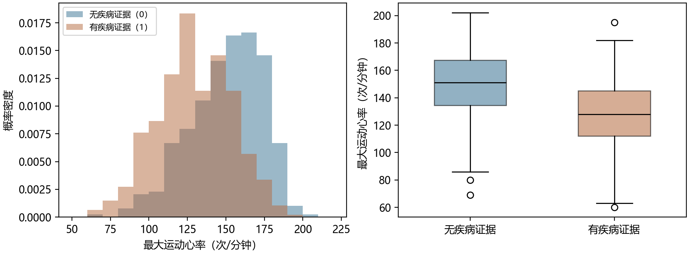
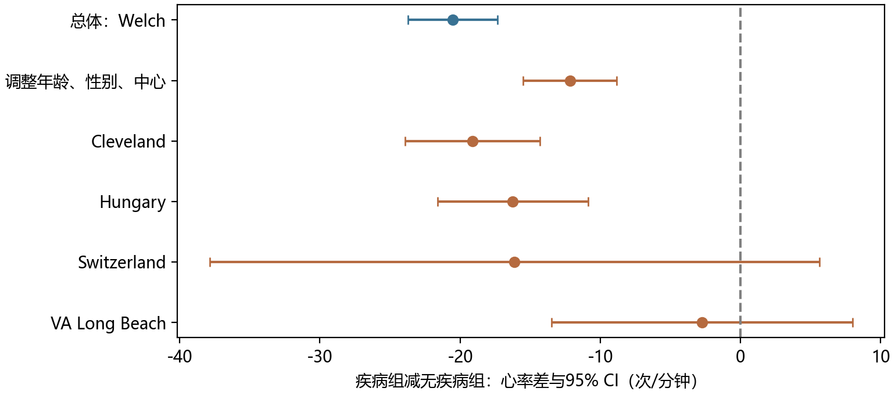

# 统计检验与假设设计
心脏病证据与最大运动心率分析报告

## 1 摘要

本报告使用四中心920名受试者的观察性横断面资料，按照课程指定主要终点thalach（最大运动心率）完成假设设计、方法选择、缺失检查和两组均值比较。55人缺少心率记录，实际分析865人：有疾病证据474人、无疾病证据391人。双侧Welch t检验得到均值差−20.54次/分钟，95% CI为[−23.73, −17.35]，p=1.30×10⁻³³。在α=0.05下拒绝均值相同的原假设。探索性调整年龄、性别和中心后，差异为−12.17次/分钟。结果支持统计关联，但缺失不均、中心差异及未测量混杂限制了因果解释和推广。

## 2 研究问题与假设设计

科学问题：在本教学数据所代表的四中心受试者中，有疾病证据者与无疾病证据者的最大运动心率总体均值是否不同？比较对象来自不同受试者，分析单位为人。每行是一条受试者记录，record_id唯一，但编号唯一不能替代对抽样过程和独立性的审查。site记录来源中心，不是随机治疗分组。

| 项目 | 定义 |
| --- | --- |
| 主要终点 | thalach：最大运动心率，连续变量，单位次/分钟 |
| 主要解释变量 | disease：二分类；1表示num>0，0表示num=0 |
| 目标参数 | Δ=μ₁−μ₀；下标1为疾病组，0为无疾病组 |
| 原假设H0 | Δ=0，即两组总体均值相同 |
| 备择假设H1 | Δ≠0，即两组总体均值存在任一方向差异 |
| 检验设置 | 双侧Welch t；α=0.05；95%置信区间 |
| 纳入规则 | disease和thalach非缺失；不要求其余无关字段完整 |
| 协变量类型 | age为连续变量；sex为二分类；site为无序分类变量 |

题目问“是否不同”，因此沿用课程指定双侧方向。不能看到疾病组较低后再改为单侧。这里的主要终点和检验方向来自作业要求；额外调整模型属于探索性补充。实验前的个人判断未留存，不将本次数据分析后的结论冒充实验前预测。推广对象应限于与这些中心转诊人群和测量流程相近的受试者，不能直接代表一般人群。

## 3 分析方法与数学依据

### 3.1 描述统计、缺失处理与Welch检验

先核对疾病编码、记录编号、缺失数及数值分布，再分别报告n、均值、样本标准差、中位数和四分位数。仅对主要检验所需字段进行完整病例筛选，空白保留为缺失，不填零，不因胆固醇等非必要字段缺失额外删人。

样本均值为x̄=Σxᵢ/n，样本方差为s²=Σ(xᵢ−x̄)²/(n−1)。均值差估计Δ̂=x̄₁−x̄₀；标准误SE=√(s₁²/n₁+s₀²/n₀)。Welch统计量为t=Δ̂/SE。令a=s₁²/n₁、b=s₀²/n₀，则自由度ν=(a+b)²/[a²/(n₁−1)+b²/(n₀−1)]。双侧p=2P(Tν≥|t|)，95% CI=Δ̂±t₀.₉₇₅,ν×SE。

Welch t检验直接回答总体均值差问题，不要求两组方差相等。需要个体记录近似独立、方差有限，且样本均值的抽样分布近似可用t分布推断。较大的组样本量有助于近似，但不能补救选择偏倚或中心相关。分布图用于检查明显偏态、极端值和组间重叠；不依据正态性检验的p值机械地切换方法。

### 3.2 五类问题的方法匹配

| 问题 | 首选方法与关键条件 | 备选方法或边界 |
| --- | --- | --- |
| 两组thalach | Welch t；独立组，目标为均值差 | Mann–Whitney U比较秩/分布；不能自动解释为中位数差 |
| 同一人前后 | 配对t；分析同一人的差值，差值均值可近似推断 | Wilcoxon符号秩需注意差值对称性；本CSV无前后测量 |
| sex与disease | 卡方独立性检验；个体独立，期望频数适当 | 稀疏2×2表用Fisher精确检验 |
| age与thalach | Pearson相关；检查线性关系和异常值 | Spearman用于单调秩关联；可用回归调整混杂 |
| 预测disease | Logistic回归；二分类结局、合理模型及独立验证 | 可考虑惩罚Logistic；OR及CI不能替代AUC、校准和验证 |

配对问题只作研究设计判断，不编造随访记录。预测题需在训练折内完成预处理、拟合及选择，验证时报告区分度与校准；本报告不声称已经完成独立预测验证，也不使用num预测由其生成的disease，以免标签泄漏。

## 4 主要分析结果

### 4.1 样本流程与描述统计

| 组别 | 原始n | 缺失n（%） | 分析n | 均值±SD | 中位数[Q1,Q3] |
| --- | --- | --- | --- | --- | --- |
| 无疾病证据 | 411 | 20（4.87%） | 391 | 148.80 ± 23.61 | 151 [134.5, 167.5] |
| 有疾病证据 | 509 | 35（6.88%） | 474 | 128.26 ± 24.02 | 128 [112.0, 145.0] |

原始920人中，thalach缺失55人（5.98%），排除后865人。age、sex、site和disease均无缺失，因此后续调整模型仍使用同一865人。心率观测范围为60–202次/分钟；无疾病组为69–202，疾病组为60–195。编号检查未发现重复record_id，且disease与(num>0)编码一致。

两组分布明显重叠，疾病组整体偏低；图中少数尾部观测不按“离群”标签自动删除。群体均值不同并不表示能仅凭该指标准确诊断每个人，个体诊断能力需要另外验证。

### 4.2 效应估计与统计决策

| 报告项 | 计算结果 |
| --- | --- |
| 均值差：疾病组减无疾病组 | −20.5389次/分钟 |
| 标准误SE | 1.6258次/分钟 |
| 95%置信区间 | [−23.7300, −17.3478]次/分钟 |
| Welch t与自由度 | t=−12.6333；ν=837.1762 |
| 双侧p值 | 1.3016×10⁻³³ |
| 决策 | p<0.05，拒绝H0；区间不包含0 |

统计证据：当前数据及检验假设下，两组总体均值相同与观测结果不相容。效应量为原始单位均值差，提示疾病组平均约低20.54次/分钟。实际意义：课程未给出临床重要差异阈值，不能仅凭极小p值认定临床价值。因果边界：观察性横断面比较不能确定时间顺序，也不能证明疾病导致心率降低、低心率导致疾病或某治疗有效。

## 5 混杂、缺失与敏感性分析

### 5.1 已观测混杂的控制

年龄、性别和中心可能同时关联疾病构成与心率测量。以thalach为连续结局拟合线性模型：thalach=β₀+β₁disease+β₂age+β₃sex+中心虚拟变量+ε。site按分类变量处理，不能编码成1、2、3、4后当连续数量。协变量依据问题与资料背景选择，不依据各自p值筛选。

| 模型（均n=865） | 疾病组差异 | 95% CI | p值 |
| --- | --- | --- | --- |
| 未调整Welch | −20.54 | [−23.73, −17.35] | 1.30×10⁻³³ |
| 调整年龄、性别 | −15.14 | [−18.47, −11.81] | 5.21×10⁻¹⁹ |
| 再调整中心 | −12.17 | [−15.50, −8.84] | 7.78×10⁻¹³ |

调整模型为探索性OLS，采用HC3异方差稳健标准误与渐近正态区间；主分析Welch区间采用t分布，二者方法不可混写。调整后差异幅度缩小，说明组构成对估计有影响，但这一变化不能单独证明已消除混杂。HC3不处理剩余中心内相关；只有4个中心，不将常规大样本聚类稳健标准误当作可靠补救。还需在后续研究检验年龄非线性、交互、中心内相关及模型设定。

四中心完整病例的疾病/无疾病组人数分别为Cleveland 139/164、Hungary 106/187、Switzerland 114/8、VA Long Beach 115/32。对应未调整均值差约为−19.12、−16.24、−16.13和−2.74次/分钟。Switzerland无疾病组仅8人，区间很宽；VA Long Beach组间差异较小。不能把“一个中心显著、另一个不显著”直接解释为中心效应存在显著差别，正式比较需交互检验与相应设计。

### 5.2 缺失不均与未测量因素

| 特征 | 心率完整（n=865） | 心率缺失（n=55） |
| --- | --- | --- |
| 平均年龄 | 53.14岁 | 59.42岁 |
| 男性比例 | 77.80% | 96.36% |
| 疾病证据比例 | 54.80% | 63.64% |
| 来自VA Long Beach | 147人 | 53人 |

55名心率缺失者中53人来自VA Long Beach；该中心缺失53/200人（26.5%），其余中心分别为0/303、1/294和1/123。缺失者年龄更大、男性比例更高，完整病例不能当然视为原始920人的无偏子样本。这些描述不能单独确定MCAR、MAR或MNAR机制。未执行插补；后续可在明确缺失机制和插补模型后采用多重插补，并进行MNAR敏感性分析。

未提供β受体阻滞剂等用药、运动能力、具体运动试验流程等变量，不能声称已控制。控制措施包括未来补充收集这些变量、明确测量方案、扩大可比来源人群，并按方案开展调整或分层分析。

Mann–Whitney U作为探索性秩分析，U=49781，双侧p=9.03e-32。它提供不同参数视角的补充证据，不能替代Welch均值差和区间，也不能在两组分布形状不同的情况下直接写成中位数差检验。

## 6 两类错误、power与多重比较

| 概念 | 本课情境中的含义 |
| --- | --- |
| 第一类错误 | 真实两组总体均值相同，却拒绝H0并报告存在差异。α控制该类长期错误率。 |
| 第二类错误 | 给定真实均值差非零，却未拒绝H0。其概率β取决于具体效应、噪声、样本量和设计。 |
| Power=1−β | 给定真实效应和设计，拒绝H0的概率。固定其他条件，样本量及真实效应增大通常提高power，噪声增大通常降低power。 |
| 未拒绝H0的边界 | 不等于证明相同；应检查CI是否仍包含重要差异、样本量和目标效应。等效性结论需要预设等效界值和专门设计。 |

本报告不把观察到的差异代入后计算“事后power”来重复描述p值。前瞻性样本量示例：假设未来独立两组等分配、共同标准差σ=24次/分钟、双侧α=0.05、目标power=80%，用正态近似n/组≈2[(z₀.₉₇₅+z₀.₈)σ/δ]²。若希望检出δ=5、10、15次/分钟，向上取整后每组约需362、91、41人。δ是规划情境，不是已确立的临床重要阈值；正式设计需用外部先验确定SD和δ，并进一步计入t分布、失访、聚类与不等分配。

若20个原假设都成立、各检验相互独立且各α=0.05，至少一次假阳性的概率为1−(1−0.05)²⁰=64.15%。指标相关时该数值不再精确。这不是某个显著结果为假的概率。只挑最显著结果会造成选择性报告和效应高估。

比较控制计划：以课程指定thalach为主要终点，双侧α=0.05；其余模型、分层和秩分析均标为探索性，并完整展示，不能按最小p值替换主结果。若将20项共同作为确认性结论，可采用Holm控制家族错误率，或Bonferroni阈值0.05/20=0.0025；大规模探索可考虑BH控制FDR并说明假设。探索性发现需要独立验证。

## 7 课后延伸：另一生物医学问题的完整设计

为覆盖教案要求，另提出一个不依赖本CSV结果的研究设计：在适合参与运动干预的成年高血压患者中，比较12周结构化有氧运动方案与常规管理对12周收缩压的影响。以下是前瞻性方案，不包含虚构患者或疗效结果。

| 设计项 | 具体方案 |
| --- | --- |
| 对象与分配 | 符合纳排标准的成年高血压患者；随机分配运动方案或常规管理，分析单位为人。 |
| 终点与变量 | 12周收缩压为连续结局；干预组别为二分类；基线收缩压、年龄为连续协变量，性别和用药类别为分类协变量。 |
| H0/H1 | 定义Δ为调整基线后的运动组减对照组均值差；H0:Δ=0，H1:Δ≠0；双侧α=0.05，同时容许获益或潜在不利方向。 |
| 主方法与备选 | ANCOVA：12周收缩压~组别+基线收缩压+预设协变量；检查残差、线性及独立性。备选可用预先规定的稳健推断或基于随机分配的检验。 |
| 至少两项混杂控制 | 随机化并按基线血压/用药分层；预设调整基线血压和年龄，记录用药变化及依从性。随机化不能保证小样本完全平衡。 |
| 缺失与多重比较 | 主要终点只设一个；意向性分析，记录失访原因，按假设进行多重插补及敏感性分析；其余终点作次要并预设Holm控制。 |
| 报告及power计划 | 报告随机化/分析n、调整均值差mmHg、95% CI、双侧p；研究前根据外部资料确定临床目标差异、SD、基线相关性和失访比例，以80%或90% power规划样本量。 |
| 结论边界 | 设计完成不代表干预有效；取得结果后区分统计显著、临床阈值及可推广人群。因果解释还需分配隐藏、测量一致和失访等条件支持。 |

## 8 四句结论：主张、证据、推理、边界

主张：在本数据心率完整的受试者中，有疾病证据者的最大运动心率平均较低，双侧Welch检验拒绝两组总体均值相同的H0。

证据：疾病组与无疾病组分析样本量为474和391，均值为128.26和148.80次/分钟；均值差−20.54，95% CI为[−23.73, −17.35]，p=1.30×10⁻³³。

推理：负的均值差和不包含0的区间共同支持组间均值差异，并展示其幅度及精度；探索性调整后仍为负，但差异幅度缩小。

边界：本研究是受中心构成、非均匀缺失及未测量混杂影响的观察性完整病例分析，尚不能确定临床重要性、个体预测能力或因果作用。

## 9 代码与可复现性

完整分析脚本为hypothesis_analysis.py，自动生成results/中的描述统计、缺失概况、Welch结果、调整模型、中心分层、样本量示例和两幅图。脚本以自身位置定位数据，不依赖终端当前目录。输入数据SHA-256：bb6aa6102f97f973f97a1f99fb5e56d9e21a21605abf6b69e2828e0051a695f1。

运行环境：python 3.12.15, numpy 2.3.5, pandas 2.3.3, scipy 1.17.1, matplotlib 3.10.8。PowerShell命令：& D:\anaconda\envs\highdim\python.exe .\hypothesis_analysis.py。报告生成脚本为build_hypothesis_report.py，需要python-docx及同级上一章参考报告。

数值校验：使用公式独立计算SE、自由度、t、p及区间，并用scipy.stats.ttest_ind(equal_var=False)及其confidence_interval核对。另用OLS未调整系数与两组均值差核对；HC3用于探索性调整推断。未对没有前后记录的数据执行配对检验，也未输出未经验证的预测性能。

## 10 资料与方法来源

课程资料：V3/slides/hypothesis-test-pbl.pptx（19页）、V3/student-worksheet.md、V3/data/README.md、V3/lesson-plan.md；数据为V3/data/heart-disease-hypothesis.csv。

SciPy官方文档：ttest_ind，https://docs.scipy.org/doc/scipy/reference/generated/scipy.stats.ttest_ind.html；mannwhitneyu，https://docs.scipy.org/doc/scipy/reference/generated/scipy.stats.mannwhitneyu.html。访问日期：2026-11-04。

NIST/SEMATECH e-Handbook：Two-Sample t-Test for Equal Means，https://www.itl.nist.gov/div898/handbook/eda/section3/eda353.htm。访问日期：2026-11-04。
