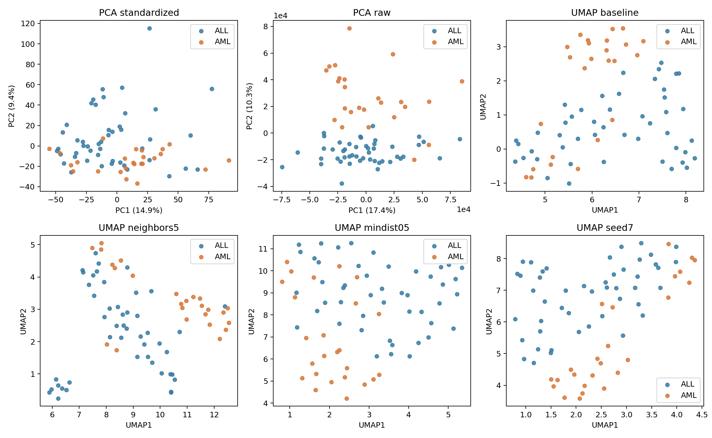
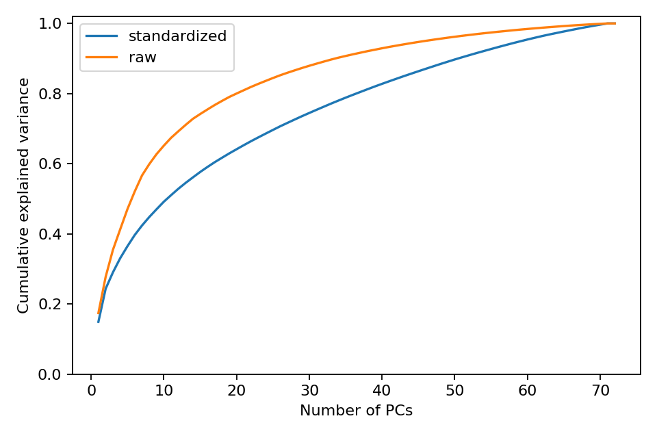

# 降维、PCA 与 UMAP：学生工作单报告

**姓名：________　学号：________　日期：2026-10-26**  
**报告状态：已完成实际实验的参考稿；个人判断与信心分数待本人填写。**

## 一、数据情况与初始判断

### 1.1 研究问题与个人记录

研究问题：白血病表达数据的二维降维图中出现分离，能否证明疾病机制，能否预测新患者？本实验比较 PCA 与 UMAP，检查预处理、参数和随机种子的影响，并用训练集内交叉验证区分数据描述与预测评价。

| 工作单项目 | 填写内容 |
|---|---|
| 实验前初始判断 | ________（未留存，由本人如实补填，不将实验后结论冒充实验前预测） |
| 实验前信心，0—100 | ________ |
| 实验前最想补充的一项证据 | ________ |
| 实验后判断 | 二维分离提供探索线索；机制、真实亚型和预测性能需要分别验证。 |
| 实验后信心，0—100 | ________（本人填写） |

### 1.2 数据与输入检查

依据本目录的 `student-worksheet.md`、`Dimension-reduction.md` 和 `data/README.md`，使用 **`data/leukemia/leukemia.csv`**。`student-package` 属于另一套材料，本报告分析的是上述白血病 CSV。

| 项目 | 实际内容 |
|---|---|
| 一行含义 | 一份白血病样本；教学编号不能作为真实患者身份依据 |
| CSV 大小 | 72 行、7,132 列 |
| 输入矩阵 X | 72 × 7,129，每列是一个探针特征 |
| 排除的元数据 | `sample_id`、`original_split`、`diagnosis` |
| 诊断分布 | ALL 47，AML 25 |
| 原始训练/测试划分 | train 38（ALL 27、AML 11）；test 34（ALL 20、AML 14） |
| 有限值、常量列检查 | 输入全部为有限数；常量探针 0 |
| 数值范围 | −28,400 至 71,369，包含负值；未直接取 log 或 log1p |
| 探针含义 | 7,129 个探针不等于 7,129 个独立基因，且包含控制探针 |
| 来源 | 据本地数据说明：OpenML leukemia，数据集 1104，版本 1；关联 Golub 等，Science，1999，DOI: 10.1126/science.286.5439.531 |

诊断标签在描述性降维拟合完成后用于着色，没有据此筛选探针。原始测试样本参与“描述全部 72 个样本”的可视化；**预测比较仅使用原始 38 个训练样本，不对原始 34 个测试样本评分或调参**。由于全数据图已可见，本报告也不宣称已完成对完全未见数据的最终预测评估。

## 二、任务 1：先确定降维目标

### 2.1 目标—输出—评价表

| 目标 | 需要的输出 | 如何判断有用 |
|---|---|---|
| 可视化 | 二维/三维坐标与带说明的图 | 能否展示可追踪的关系；跨参数是否稳定；是否说明失真 |
| 去噪 | 保留部分成分后的表示或重构数据 | 重复测量一致性、重构或独立验证是否改善，不能只看图更平滑 |
| 压缩特征 | 较少成分与变换规则 | 成分数、累计解释率、存储成本和重构误差之间的权衡 |
| 发现样本结构 | 候选邻域、异常样本或候选分组 | 跨参数、批次、独立数据是否重现，有无外部注释支持 |
| 后续模型输入 | 训练范围内学得的变换及预测模型 | 与同折基线比较验证指标，方案固定后评估独立测试数据 |

### 2.2 两条流程及拟合范围

**描述性流程：**全部 72 个样本表达矩阵 → 在全部样本上拟合按列标准化 → 在标准化矩阵上拟合 PCA/UMAP → 事后按诊断着色 → 描述当前数据。不能从该图直接得出新患者的预测性能。

**预测流程：**先划分数据 → 每个训练折内拟合 StandardScaler → 同一训练折内拟合 PCA（若使用）→ 同一训练折内拟合分类器 → 用已拟合变换转换验证折并预测 → 汇总指标 → 固定方案后在训练集重拟合、评估独立测试集。本次仅执行训练集内交叉验证。

PCA 不使用诊断标签，但会学习均值和协方差，StandardScaler 还会学习尺度。如果先在全数据上拟合再交叉验证，验证折分布已经影响变换，仍有信息泄露。因此所有预测拟合步骤放在 Pipeline 中，由每折训练部分独立学习。

### 2.3 可选验证：原始训练集内三折比较

固定 `StratifiedKFold(n_splits=3, shuffle=True, random_state=42)`，在相同折中比较两个 Pipeline。PCA 使用 `n_components=10, svd_solver='full'`；分类器都是欧氏距离 1 近邻。

| 验证折 | StandardScaler → 1NN | StandardScaler → PCA(10) → 1NN |
|---|---:|---:|
| 1 | 0.819444 | 0.694444 |
| 2 | 0.875000 | 0.763889 |
| 3 | 0.833333 | 0.833333 |
| 三折算术平均 | **0.842593** | **0.763889** |

指标为 balanced accuracy，即 ALL、AML 两类召回率的平均值，不是总正确率。每折训练分数均为 1.0，对在训练样本上评分的 1NN 并不意外，不能证明泛化能力。此固定比较中 PCA(10) 没有提高平均验证指标；样本只有 38 个，不能推广为“PCA 永远无用”。

## 三、任务 2：PCA 保留与丢失的信息

### 3.1 中心化、标准化及检查

每个探针单独计算其在 72 个样本中的均值 μ、总体标准差 σ（`ddof=0`）。

- **中心化：**每个值减去该列均值，即 `x − μ`，使均值为 0，保留原尺度。
- **标准化：**再除以该列标准差，即 `z = (x − μ) / σ`，按“偏离自身均值多少个标准差”比较探针。
- 按列标准化与芯片原始数据的上游归一化不是同一步，不能相互替代；本次不重建上游处理，也不对含负值的矩阵直接取对数。

实际检查：标准化后列均值绝对值的最大值为 **5.98 × 10⁻¹⁶**；列总体标准差与 1 的差的绝对值最大为 **3.33 × 10⁻¹⁶**，属于浮点误差。

### 3.2 解释率与图

| 输入方案 | PC1 | PC2 | 前两项合计 | 达到 80% 的最少成分 | 达到 90% 的最少成分 |
|---|---:|---:|---:|---:|---:|
| 按列标准化 PCA | 14.9216% | 9.4462% | **24.3678%** | **37** | **51** |
| 原尺度 PCA，仅中心化 | 17.4278% | 10.3386% | **27.7664%** | **20** | **34** |



**图 1。**第一行：标准化 PCA、原尺度 PCA、基线 UMAP。第二行：仅改邻居数、仅改 min_dist、仅改种子。蓝色 ALL，橙色 AML。各面板方向和距离不能直接对应；原尺度 PCA 轴使用科学计数法。



**图 2。**两种输入方案的累计解释率。标准化方案的前两维保留其输入总方差约 24.37%，其余约 75.63% 未在二维投影中表现。“保留方差”不能理解为保留同等比例的疾病信息或预测能力。

标准化 PCA 图中两类有重叠，也有部分诊断相关分布趋势；二维不足以概括高维差异。原尺度图的布局有所改变，其前两维解释率更高也不表示方案更好，因为两方案解释率的分母是不同预处理空间中的总方差。

### 3.3 PC1 的前五个绝对权重探针

本工作单将 **`pca.components_.T` 定义为 loading（方向权重）**，未再乘特征值的平方根。

**标准化 PCA：**

| 探针 | PC1 带符号权重 | 原尺度总体标准差 |
|---|---:|---:|
| X92518_s_at | +0.02878558 | 326.91 |
| X95190_at | -0.02817682 | 363.72 |
| X98253_at | +0.02792670 | 348.96 |
| X82895_at | +0.02787138 | 355.47 |
| Y09616_at | +0.02775694 | 531.14 |

对样本 i，`PC1_i = Σ_j w_j × z_ij`，是全部 7,129 个标准化探针的加权和。例如 `X92518_s_at` 的一项贡献为 `0.02878558 × z_i,X92518_s_at`；前五探针不是 PC1 的完整公式。

PC1 在单位长度的线性方向中使样本投影方差最大。它是多探针的组合，不等于一个基因，也不以最大化 ALL/AML 分类效果为目标。正权重说明对当前 PC1 正方向的贡献，不能直接解释成致病作用或在 AML 中一定上调。

**原尺度 PCA：**

| 探针 | PC1 带符号权重 | 原尺度总体标准差 |
|---|---:|---:|
| M25079_s_at | +0.35238761 | 15782.80 |
| hum_alu_at | +0.31355189 | 10806.78 |
| HG1428-HT1428_s_at | +0.23486702 | 10956.53 |
| L06499_at | +0.21045324 | 7625.23 |
| J04617_s_at | +0.19625269 | 6846.94 |

两套前五探针没有重合。原尺度高权重探针的原始标准差约 6,847—15,783，标准化方案所列探针约 327—531，表明尺度处理明显影响方向。原尺度容易受大方差特征影响；标准化使输入各探针方差相同，也可能提高低变异噪声的相对影响，不能自动视为生物学最优处理。

### 3.4 必答问题

| 问题 | 回答 |
|---|---|
| PC1 最大化什么？ | 当前预处理空间中样本沿单位方向投影的方差，没有使用诊断优化。 |
| 权重整体变号会怎样？ | 得分一起变号，图左右翻转；解释率、相对距离与实质结构不变。 |
| 为什么至多 71 个非零主成分？ | 中心化后 72 个样本向量之和为零，秩至多 min(72−1,7129)=71。程序可返回 72 项，但最后一项至多为数值误差量级。 |
| 一句解释 PC1 | 标准化 PC1 是解释当前样本总方差 14.9216% 的探针加权表达方向。 |
| 一句不能据此推出的结论 | 高权重及诊断分布趋势不能直接证明疾病机制、因果基因或新患者预测能力。 |

## 四、任务 3：UMAP 的结构与稳定性

### 4.1 基线及三个单因素对照

使用同一个 72 × 7,129 标准化矩阵，不按诊断选探针。共同参数为 `n_components=2, metric='euclidean', n_jobs=1`。

| 设置 | n_neighbors | min_dist | random_state | 原空间 5 近邻保留比例 | 与基线的二维 5 近邻重合比例 |
|---|---:|---:|---:|---:|---:|
| baseline | 15 | 0.1 | 42 | 41.11% | 100.00%（自身对照） |
| neighbors5 | 5 | 0.1 | 42 | 45.56% | 55.28% |
| mindist05 | 15 | 0.5 | 42 | 40.00% | 64.17% |
| seed7 | 15 | 0.1 | 7 | 40.56% | 60.28% |

**指标定义：**逐样本取欧氏距离的 5 个最近邻（排除自身），两套邻居集合交集的大小除以 5，再对 72 个样本平均。“原空间”指标准化 7,129 维空间。以上为描述性指标，不是分类准确率、显著性检验或机制验证；也不能只因 neighbors5 此项较高就说它整体最优。

图 1 中邻居数变化改变局部组团与布局；min_dist 变化影响点的分散程度；仅换种子也改变方向与位置。应追踪同一样本及邻居，不能给“左边/右边”赋予固定生物学含义。

### 4.2 稳定局部关系

对四个二维嵌入各计算 5 近邻，再求集合交集。G004 的五个邻居在四组中均为 **G001、G007、G008、G027、G049**；G008 的稳定五邻居为 **G001、G004、G007、G027、G049**，支持这些局部关系在本次设置下较稳定。G010 四组邻居的交集为空，表明并非所有样本都稳定。

这只描述本次数据与四组设置，即使嵌入邻域稳定，也需要检查原空间、批次和独立数据。全部记录在 `umap-stable-neighbors.csv`，坐标表保留样本编号。本实验未运行聚类算法，没有报告真实簇数；视觉岛屿数量、间距、方向、面积均不应当作稳定的生物学量。

### 4.3 PCA/UMAP 比较

| 比较项 | PCA | UMAP |
|---|---|---|
| 线性/非线性 | 线性投影 | 非线性嵌入 |
| 保留目标 | 依次保留最大的投影方差；固定维数下最小化平方重构误差 | 构建并近似保留邻域图关系，偏重局部结构 |
| 轴含义 | 特征的线性加权组合，可查看 loading | 嵌入坐标，单个轴通常没有固定生物学解释 |
| 方差解释率 | 可以计算，需说明预处理 | 没有与 PCA 同义的解释率 |
| 局部/全局 | 可能丢失低方差的重要局部差异；二维不保留全部距离 | 局部关系仍需验证；远处岛屿间距、方向、面积不可直接实义解释 |
| 参数/随机性 | 受标准化与成分数影响；本次 full SVD 可复现，整体符号不重要 | 邻居数、min_dist、度量和种子影响布局 |
| 预测防泄露 | Scaler 与 PCA 在训练折拟合，再转换验证/测试 | Scaler 与 UMAP 在训练折拟合，用同一模型转换验证/测试，再独立评价分类器 |

### 4.4 三条支持与限制

1. **支持：**部分局部邻域跨设置重现，可作为候选结构。**不能支持：**凭岛屿数认定真实疾病亚型数。
2. **支持：**当前表达结构与诊断着色有值得研究的关联。**不能支持：**凭图中分离证明机制、因果关系或新患者准确率。
3. **支持：**高维数据的局部关系能帮助探索复杂表型和单细胞候选结构，故 UMAP 常用于此类展示。**不能支持：**把岛屿间距、方向和面积直接解释为演化距离、疾病阶段或细胞群体占比。

数据缺少批次字段，不能宣称已经排除批次效应。后续需补齐批次、中心、技术与临床信息，教学样本编号也不能证明患者独立性。

## 五、任务 4 与退出卡：主张—证据—推理—边界

1. **主张：**本次二维降维图提供样本结构的探索线索，尚不足以证明疾病机制或新患者预测能力。
2. **证据：**标准化 PCA 前两维仅解释 24.3678% 方差；UMAP 仅将邻居数由 15 改为 5，与基线二维 5 近邻的平均重合比例为 55.28%。
3. **推理：**二维遗漏较多高维变异，邻域和布局受设定影响，因此分离产生的是待检验假设，不能替代机制研究与独立预测评价。
4. **边界与下一步：**当前仅有 72 个样本且缺少批次信息，应在补齐批次等信息的独立队列中复核结构，并以预先固定的完整 Pipeline 评估预测，若提出机制结论还需针对候选通路做功能验证。

## 六、三道课后题

### 题 1：PCA 第一主成分代表什么？

它是由全部探针共同决定的线性方向，使样本沿这个方向投影后最分散。本次标准化 PC1 解释总方差 14.9216%，`X92518_s_at` 的权重为 +0.02878558，该探针的标准化数值乘这个权重后贡献到 PC1 得分中。PC1 是全部 7,129 个探针的组合，不能只用这一个探针代表，也不是专门区分诊断的方向。

### 题 2：为什么考虑标准化，作用与代价是什么？

PCA 关注方差，原始波动大的特征容易影响方向。标准化后，每个探针以自身标准差为单位参与比较。本次标准化前后前五高权重探针完全不同，原尺度高权重探针的原始标准差明显更大，说明尺度处理实质影响结果。代价是低变异噪声可能被相对放大，原有绝对波动也被重新加权。应结合原尺度对照和任务目标选择，不能只看谁的解释率较高。

### 题 3：UMAP 能与不能说明什么？

它能展示当前数据在指定设定下的局部关系，帮助找出值得追踪的样本和候选结构。仅将种子从 42 改为 7，二维 5 近邻与基线的平均重合比例约 60.28%，表明部分邻域保留但并非完全稳定。图不能直接证明疾病机制、真实亚型数或新患者预测准确率；上下左右也无固定生物学意义。需结合参数对照、样本追踪、批次检查和独立数据验证。

## 七、复现与提交

| 软件 | 实际运行版本 |
|---|---|
| Python | 3.12.15 |
| numpy | 2.3.5 |
| pandas | 2.3.3 |
| scipy | 1.17.1 |
| scikit-learn | 1.8.0 |
| umap-learn | 0.5.12 |
| matplotlib | 3.10.8 |

- 环境：conda `highdim`；解释器 `D:\anaconda\envs\highdim\python.exe`。
- 输入：7,129 个探针列，未按标签筛选，未直接取对数。
- 描述性拟合：全部 72 个样本；预测验证：原始 train 的 38 个样本，每折独立拟合。
- 标准化：按列中心化、总体标准差缩放；PCA 为 full SVD。
- UMAP：二维、欧氏距离、n_jobs=1；基线种子 42，对照种子 7，详见任务 3。
- CV：三折分层，shuffle=True，种子 42；未以原始测试集分数选择方案。
- 输入 CSV 的 SHA-256：`915bce00295ac470f6bd970a4032730a170a080642a5da53ab0bcb0545156f19`。

在课程根目录的 PowerShell 中执行：

```powershell
& 'D:\anaconda\envs\highdim\python.exe' '.tmp\dimension-reduction\student_analysis.py'
```

| 文件 | 用途 |
|---|---|
| [完整分析脚本](.tmp/dimension-reduction/student_analysis.py) | 分析和绘图，可重新运行 |
| [运行摘要](.tmp/dimension-reduction/student-results/summary.json) | 版本、校验值、标准化与降维指标 |
| [三折验证结果](.tmp/dimension-reduction/student-results/cross-validation.csv) | 每折训练与验证分数 |
| [PCA 解释率](.tmp/dimension-reduction/student-results/pca-variance.csv) | 各成分和累计解释率 |
| [PCA 权重](.tmp/dimension-reduction/student-results/pca-loadings.csv) | 两方案前五探针 |
| [标准化 PCA 坐标](.tmp/dimension-reduction/student-results/pca-standardized-coordinates.csv) | 样本对应关系 |
| [原尺度 PCA 坐标](.tmp/dimension-reduction/student-results/pca-raw-coordinates.csv) | 样本对应关系 |
| [UMAP 基线](.tmp/dimension-reduction/student-results/umap-baseline-coordinates.csv) | 坐标与样本编号 |
| [邻居数对照](.tmp/dimension-reduction/student-results/umap-neighbors5-coordinates.csv) | 坐标与样本编号 |
| [min_dist 对照](.tmp/dimension-reduction/student-results/umap-mindist05-coordinates.csv) | 坐标与样本编号 |
| [随机种子对照](.tmp/dimension-reduction/student-results/umap-seed7-coordinates.csv) | 坐标与样本编号 |
| [稳定邻居](.tmp/dimension-reduction/student-results/umap-stable-neighbors.csv) | 四组共有的二维 5 近邻 |

提交 Markdown 应一并提供图片与代码，保留目录结构，也可从 Markdown 预览导出含图文档。个人身份、信心等空白由本人填写；分析文字为参考稿，请理解后用自己的话确认或修改。

## 附录：完整可运行代码

代码依次完成：定位输入 → 校验数据 → 标准化 → 折内预测比较 → 两种 PCA → 四组 UMAP 与邻域追踪 → 绘图与保存。下面保留完整代码，便于逐行对照学习。

```python
"""Reproduce teacher-reference evidence; run from any working directory."""
from pathlib import Path
import os
import sys

BASE = Path(__file__).resolve().parents[2]
WORK = BASE / '.tmp/dimension-reduction'
sys.dont_write_bytecode = True
os.environ.setdefault('NUMBA_CACHE_DIR', str(WORK / 'numba-cache'))
os.environ.setdefault('MPLCONFIGDIR', str(WORK / 'matplotlib'))
import hashlib
import importlib.metadata
import json
import platform
import numpy as np
import pandas as pd
import matplotlib
matplotlib.use('Agg')
import matplotlib.pyplot as plt
from scipy.spatial.distance import pdist, squareform
from sklearn.preprocessing import StandardScaler
from sklearn.decomposition import PCA
from sklearn.pipeline import make_pipeline
from sklearn.neighbors import KNeighborsClassifier
from sklearn.model_selection import StratifiedKFold, cross_validate
from umap import UMAP

OUT = WORK / 'student-results'
OUT.mkdir(parents=True, exist_ok=True)
src = BASE / 'data/leukemia/leukemia.csv'
df = pd.read_csv(src)
X = df.iloc[:, 3:].to_numpy(dtype=float)
y = df.diagnosis.to_numpy()
names = df.columns[3:].to_numpy()
train = df.original_split.eq('train').to_numpy()
assert X.shape == (72, 7129) and np.isfinite(X).all()
expected = json.loads((BASE / 'data/inspection.json').read_text())['sha256']['leukemia/leukemia.csv']
assert hashlib.sha256(src.read_bytes()).hexdigest() == expected
Z = StandardScaler().fit_transform(X)
cv = StratifiedKFold(n_splits=3, shuffle=True, random_state=42)
cv_rows = []
for use_pca in [False, True]:
    steps = [StandardScaler()]
    if use_pca:
        steps.append(PCA(n_components=10, svd_solver='full'))
    steps.append(KNeighborsClassifier(n_neighbors=1, metric='euclidean'))
    scores = cross_validate(make_pipeline(*steps), X[train], y[train], cv=cv,
                            scoring='balanced_accuracy', return_train_score=True)
    for fold, (tr, va) in enumerate(zip(scores['train_score'], scores['test_score']), 1):
        cv_rows.append(dict(labels='real', pca10=use_pca, fold=fold, train_ba=tr, validation_ba=va))
pd.DataFrame(cv_rows).to_csv(OUT / 'cross-validation.csv', index=False)
summary = {'python': platform.python_version(),
           'packages': {n: importlib.metadata.version(n) for n in ['numpy','pandas','scipy','scikit-learn','umap-learn','matplotlib']},
           'csv_sha256': expected, 'n': len(X), 'p': X.shape[1],
           'standardization': {'max_abs_mean': float(abs(Z.mean(axis=0)).max()),
                               'max_abs_sd_minus_one': float(abs(Z.std(axis=0)-1).max())},
           'pca': {}, 'umap': []}
loadings = []; embeddings = {}; variance_rows = []
for kind, A in [('standardized', Z), ('raw', X)]:
    pca = PCA(svd_solver='full').fit(A)
    embedding = pca.transform(A)[:, :2]
    embeddings[kind] = embedding
    evr = pca.explained_variance_ratio_; cumulative = np.cumsum(evr)
    top = np.argsort(abs(pca.components_[0]))[::-1][:5]
    summary['pca'][kind] = {'pc1': float(evr[0]), 'pc2': float(evr[1]), 'pc1_pc2':float(cumulative[1]),
        'n80':int(np.searchsorted(cumulative, .8)+1), 'n90':int(np.searchsorted(cumulative, .9)+1),
        'top5': [{'probe':names[i], 'weight':float(pca.components_[0,i]), 'raw_sd':float(X[:,i].std())} for i in top]}
    for k, (v,c) in enumerate(zip(evr,cumulative),1):
        variance_rows.append(dict(input=kind, component=k, explained_ratio=v, cumulative=c))
    for i in top:
        loadings.append(dict(input=kind, probe=names[i], weight=pca.components_[0,i], raw_sd=X[:,i].std()))
    pd.DataFrame({'sample_id':df.sample_id, 'diagnosis':y, 'PC1':embedding[:,0], 'PC2':embedding[:,1]}).to_csv(OUT/f'pca-{kind}-coordinates.csv', index=False)
pd.DataFrame(loadings).to_csv(OUT/'pca-loadings.csv', index=False)
vr = pd.DataFrame(variance_rows); vr.to_csv(OUT/'pca-variance.csv', index=False)
fig, ax = plt.subplots(figsize=(6,4))
for kind in ['standardized','raw']:
    a=vr[vr.input==kind]; ax.plot(a.component,a.cumulative,label=kind)
ax.set(xlabel='Number of PCs',ylabel='Cumulative explained variance',ylim=(0,1.02)); ax.legend()
fig.tight_layout(); fig.savefig(OUT/'pca-variance.png',dpi=160); plt.close(fig)

def neighbors(A, k=5):
    D=squareform(pdist(A)); np.fill_diagonal(D,np.inf)
    return np.argsort(D,axis=1)[:,:k]

original_neighbors = neighbors(Z); umap_neighbors = {}
for label, nn, md, seed in [('baseline',15,.1,42),('neighbors5',5,.1,42),('mindist05',15,.5,42),('seed7',15,.1,7)]:
    print('Fitting UMAP:',label,flush=True)
    emb = UMAP(n_components=2,n_neighbors=nn,min_dist=md,metric='euclidean',random_state=seed,n_jobs=1).fit_transform(Z)
    assert emb.shape==(72,2) and np.isfinite(emb).all()
    embeddings[label] = emb
    knn = neighbors(emb); umap_neighbors[label] = knn
    retain = np.mean([len(set(a)&set(b))/5 for a,b in zip(original_neighbors,knn)])
    overlap = np.mean([len(set(a)&set(b))/5 for a,b in zip(umap_neighbors['baseline'],knn)])
    summary['umap'].append(dict(setting=label,n_neighbors=nn,min_dist=md,seed=seed,
                                original_knn5_retained=float(retain),baseline_knn5_overlap=float(overlap)))
    pd.DataFrame({'sample_id':df.sample_id,'diagnosis':y,'UMAP1':emb[:,0],'UMAP2':emb[:,1]}).to_csv(OUT/f'umap-{label}-coordinates.csv',index=False)
stable_rows=[]
for i in range(len(X)):
    shared = set.intersection(*(set(knn[i]) for knn in umap_neighbors.values()))
    stable_rows.append(dict(sample_id=df.sample_id.iloc[i],all_settings_neighbors=';'.join(df.sample_id.iloc[j] for j in sorted(shared)),count=len(shared)))
pd.DataFrame(stable_rows).to_csv(OUT/'umap-stable-neighbors.csv',index=False)
fig, axes = plt.subplots(2,3,figsize=(13,8))
for ax,key in zip(axes.flat,['standardized','raw','baseline','neighbors5','mindist05','seed7']):
    emb=embeddings[key]
    for label,color in [('ALL','#387ca3'),('AML','#d57839')]:
        mask=y==label; ax.scatter(emb[mask,0],emb[mask,1],s=24,c=color,label=label,alpha=.85)
    if key in summary['pca']:
        info=summary['pca'][key]
        ax.set(xlabel=f"PC1 ({info['pc1']:.1%})",ylabel=f"PC2 ({info['pc2']:.1%})",title='PCA '+key)
    else:
        ax.set(xlabel='UMAP1',ylabel='UMAP2',title='UMAP '+key)
    if key == 'raw':
        ax.ticklabel_format(axis='both', style='sci', scilimits=(0, 0))
    ax.legend()
fig.tight_layout(); fig.savefig(OUT/'pca-umap.png',dpi=180); plt.close(fig)
(OUT/'summary.json').write_text(json.dumps(summary,indent=2),encoding='utf-8')
print(json.dumps(summary,indent=2),flush=True)
```
